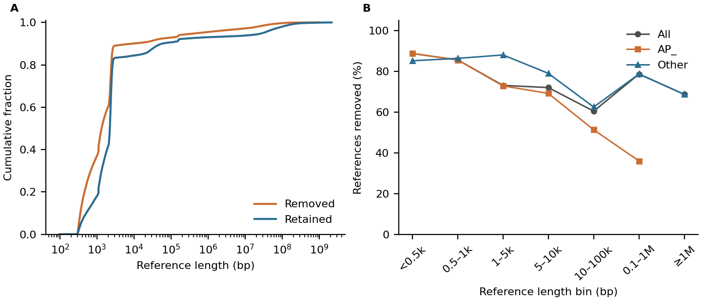
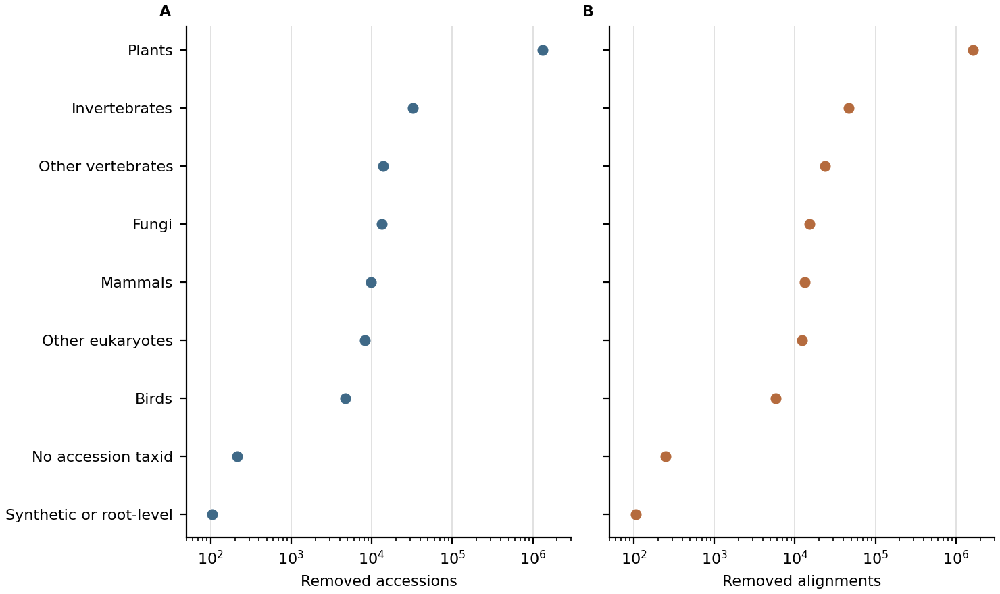
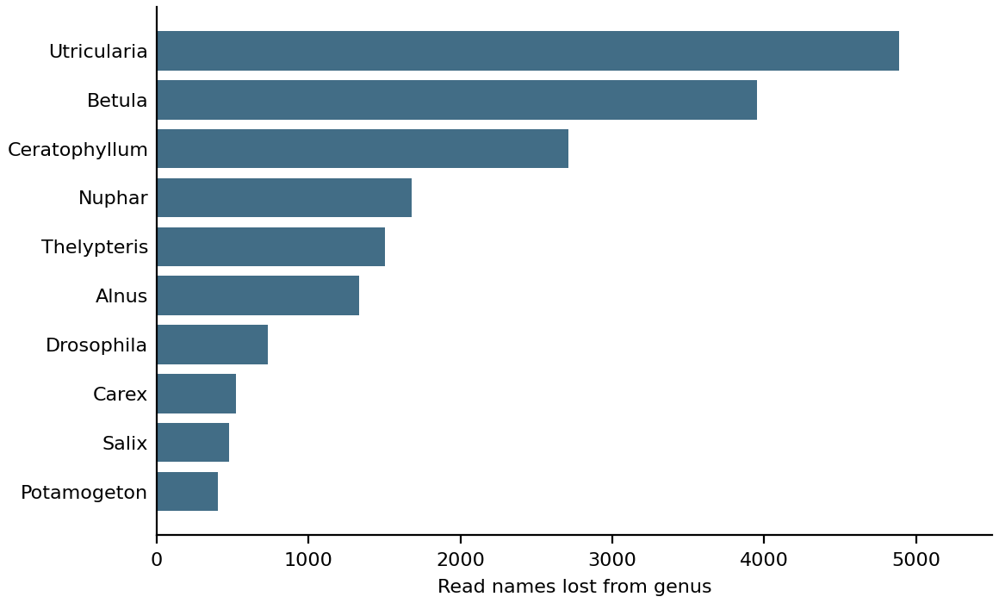
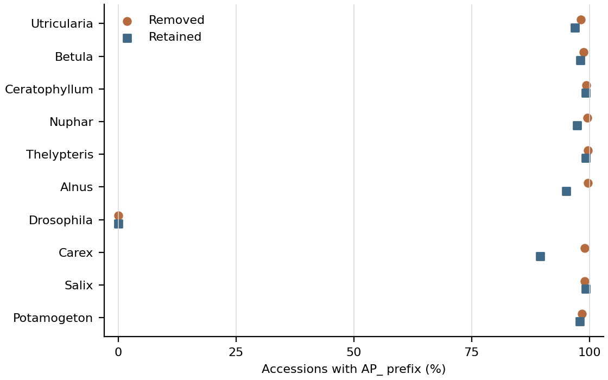

# Alignment reporting and minimum-read filtering: empirical audit

**Date:** 20–21 November 2026  
**Data:** `Lib_LV7008960905_collapsed.bam` (678,469,394 bytes; query-name grouped)  
**Pipeline tested:** `alnfilt --mode ALLTOP --minani 93 --maxani 100`, then reference-level `refstats --minreads 3`  
**Taxonomy:** BAM-specific accession-to-taxid map and NCBI `names.dmp`/`nodes.dmp`; merged taxids resolved for broad-group classification

## Question and design

The work began with a request for a default `alnfilt` run summary that reports
alignment and read losses, BAM sizes, median read lengths, and timing without
meaningfully slowing filtering. The subsequent question was whether
`refstats --minreads 3` discards reads from taxa that remain supported by other
accessions. We compared the saved filtered BAM and statistics tables, then
piloted a threshold on **distinct read names pooled by taxid**, species, or
genus. Finally, we examined reference length, broad taxonomy, the most
affected genera, and the `AP_` identifier prefix.

The counts below refer to this BAM and this reference catalogue. `ALLTOP`
retains multiple top alignments for a read, so alignment records and
taxon-associated read names are different units.

## 1. Default `alnfilt` run statistics

With a named output BAM, `alnfilt` now writes a BGZF-compressed
`<outbam>.stats.tsv.gz` report by default. It records before/after alignments
and query names, removed counts and percentages, read-length medians, input
and output sizes, wall time, and CPU time. It does not apply a minimum-read
threshold, so `reads_removed_below_minreads` is `NA`. `--no-stats` avoids the
report and median calculation; `--outstat` selects another path. Input BAMs
remain intact unless the explicit `--delete-input` option is used after
successful output. The empirical run reported:

| Measure | Input | After `alnfilt` | Removed |
|:--|--:|--:|--:|
| Alignment records | 40,366,891 | 8,189,896 | 32,176,995 (79.71%) |
| Distinct query names | 519,624 | 248,549 | 271,075 (52.17%) |
| Median read length | 32 bp | 33 bp | — |
| BAM size | 678.469 MB | 196.973 MB | — |

Matched Apple Clang builds were alternated over three runs each on this Mac,
using four threads and BAM compression level 5. The committed `e97ab5c`
build is the baseline; the updated build included the statistics feature.

| Build | Median wall time | Median total CPU time | Median peak RSS |
|:--|--:|--:|--:|
| Baseline | 12.936 s | 27.078 s | 1.672 GB |
| Updated, default statistics | 13.013 s | 27.085 s | 1.709 GB |
| Updated, `--no-stats` | 12.735 s | 26.973 s | 1.690 GB |

The default report was 0.6% slower by median wall time, with almost identical
CPU time and 37 MB higher median peak RSS. One updated run reached 2.04 GB;
three repeats do not establish that these small differences are systematic.
Decoded alignment records from the baseline and updated output had identical
SHA-256 digests. All 38 repository tests passed in the initial validation;
after integrating the two newer `dev2` commits, all 39 tests passed locally.
These measurements are for a 678 MB input, not a terabyte-scale benchmark.

## 2. Effect of the reference-level cutoff

The saved `refstats --minreads 3` table identifies the accessions that pass;
the others have one or two distinct read names. A query-grouped scan of the
8,189,896-alignment `alnfilt` BAM reproduced the filtered BAM totals.

| Measure | Before `refstats` cutoff | After | Removed |
|:--|--:|--:|--:|
| Accessions with alignments | 1,806,272 | 411,110 | 1,395,162 (77.24%) |
| Alignment records | 8,189,896 | 6,442,162 | 1,747,734 (21.34%) |
| Distinct read names in BAM | 248,549 | 192,146 | 56,403 (22.69%) |

Another 64,866 read names lost at least one alignment but remained through a
different passing accession. Of the 56,403 names removed completely, 35,474
(62.9%) had mapped to a discarded accession whose **assigned taxid** still
had another passing accession. At genus rank, 41,007 (72.7%) of the fully
lost names mapped to a genus with another passing accession. This is the
central limitation of an accession-level read threshold in a fragmented or
uneven reference catalogue.

## 3. Taxon-level cutoff pilot

We then tested a threshold of three distinct read names **across all
accessions in a taxon**, using the original `alnfilt` BAM. The threshold was
applied independently at assigned taxid, species, and genus/fallback taxid.

| Rule at three names | Retained alignments | Retained read names | Names lost from the BAM |
|:--|--:|--:|--:|
| Accession-level `refstats` | 6,442,162 | 192,146 | 56,403 |
| Assigned accession taxid | 8,152,782 | 246,778 | 1,771 |
| Species | 8,152,752 | 246,775 | 1,774 |
| Genus/fallback taxid | 8,176,534 | 247,857 | 692 |

The last three rows count run-wide unions of read names; they are not sums of
taxon rows. A separate two-pass BAM-writing pilot reproduced the assigned-
taxid counts and passed `samtools quickcheck`. The output BAM was deleted
after validation. A native taxon-filtered BAM path is **not yet implemented**:
`taxstats -o/--outbam` currently accepts the option but does not emit a BAM.
The pilot's assigned-taxid `taxstats` run took 26.76 s wall time, 28.65 s
total CPU time, and 2.98 GB peak RSS; the separate Python BAM-writing pass
took 12.48 s wall time and 1.18 GB peak RSS. Species and genus `taxstats`
runs used 3.01 and 2.42 GB peak RSS, respectively. These are sample-specific
measurements; neither implementation has been tested on a terabyte BAM.

## 4. Are rejected accessions short?

Yes overall, especially among `AP_` accessions, though long references are
also rejected when read support is low. Length is the `LN` value in each BAM
`@SQ` record.

| References | Removed | Retained |
|:--|--:|--:|
| All: median length | 1,329 bp | 2,219 bp |
| `AP_`: median length | 1,191 bp | 2,101 bp |
| Other accessions: median length | 180,781 bp | 204,932 bp |
| All: fraction under 1 kb | 37.1% | 18.1% |

References below 500 bp were rejected at 88.7%, but **62,638 references at
least 1 Mb long** were also rejected (68.7% of that length bin). Among removed
accessions with another passing accession at the exact assigned taxid, the
median length was 1,268 bp (1,309,743 accessions). Removed accessions without
that exact-taxid support had a median length of 151,488 bp (85,419
accessions). This makes the same-taxon fragmentation problem particularly
prominent among short reference records.

**Figure 1.** (A) Empirical cumulative distributions of BAM reference lengths
for removed and retained accessions. (B) Fraction removed within each length
bin, overall and by `AP_` prefix. Percentages use accessions, not reads, as
their denominator. [Vector figure](minreads-audit-images/reference_length_filtering.pdf).

## 5. Which broad taxonomic groups are affected?

Taxids were traced to nonoverlapping NCBI groups. Mammals and birds are shown
separately from other vertebrates; invertebrates are Metazoa outside
Vertebrata. Plant means Viridiplantae.

| Group | Removed accessions | Share of all removed | Removed alignments |
|:--|--:|--:|--:|
| Plants | 1,312,749 | 94.09% | 1,630,405 |
| Invertebrates | 32,190 | 2.31% | 46,843 |
| Other vertebrates | 13,972 | 1.00% | 23,673 |
| Fungi | 13,239 | 0.95% | 15,204 |
| Mammals | 9,732 | 0.70% | 13,330 |
| Other eukaryotes | 8,266 | 0.59% | 12,183 |
| Birds | 4,696 | 0.34% | 5,740 |
| Synthetic/root-level or without taxid | 318 | 0.02% | 356 |

Plants also account for 93.29% of removed alignment records. Of the removed
plant accessions, 1,231,543 (93.81%) have an `AP_` prefix. The BAM header
contains no bacterial, archaeal, or viral reference records. The 255 names
without a BAM-specific taxid include 213 removed and 42 retained accessions.
These distributions describe the reference catalogue, not organism abundance.

**Figure 2.** Counts of removed accessions (A) and alignment records (B) by
taxonomic group. Horizontal axes are logarithmic to retain the smaller groups.
[Vector figure](minreads-audit-images/taxonomic_groups.pdf).

## 6. Which genera lose the most read names?

The comparison uses distinct read names associated with each genus before
and after the accession-level cutoff. A read can lose one genus association
while retaining an alignment elsewhere in the BAM.

| Genus | Before | After | Lost from genus | Lost % | Fully absent from BAM |
|:--|--:|--:|--:|--:|--:|
| *Utricularia* | 5,871 | 983 | 4,888 | 83.3% | 4,820 |
| *Betula* | 7,360 | 3,405 | 3,955 | 53.7% | 1,793 |
| *Ceratophyllum* | 18,075 | 15,364 | 2,711 | 15.0% | 2,605 |
| *Nuphar* | 1,929 | 253 | 1,676 | 86.9% | 1,625 |
| *Thelypteris* | 3,202 | 1,698 | 1,504 | 47.0% | 1,354 |
| *Alnus* | 89,871 | 88,538 | 1,333 | 1.5% | 1,280 |
| *Drosophila* | 842 | 110 | 732 | 86.9% | 574 |
| *Carex* | 2,313 | 1,794 | 519 | 22.4% | 319 |
| *Salix* | 4,818 | 4,343 | 475 | 9.9% | 391 |
| *Potamogeton* | 1,828 | 1,426 | 402 | 22.0% | 364 |

The prefilter genus table suppresses rows below 10 names, but such rows
cannot enter this top ten. The postfilter table used a minimum of one name.
For *Betula*, 3,955 names lost their genus association, while only 1,793
disappeared entirely; the remainder retained an alignment elsewhere. The
largest proportional losses among these genera are *Drosophila*, *Nuphar*,
and *Utricularia*. *Alnus* loses many names in absolute terms but only 1.5%
of its original genus-associated names.

**Figure 3.** Ten genera with the most distinct read names lost from that
genus. A name contributes once per genus regardless of alignment count.
[Vector figure](minreads-audit-images/top_genera.pdf).

## 7. How many accessions have an `AP_` prefix?

| Genus | `AP_` among all accessions | `AP_` among removed accessions |
|:--|--:|--:|
| *Utricularia* | 97.88% | 98.24% |
| *Betula* | 98.42% | 98.72% |
| *Ceratophyllum* | 99.34% | 99.39% |
| *Nuphar* | 99.51% | 99.58% |
| *Thelypteris* | 99.60% | 99.68% |
| *Alnus* | 98.18% | 99.72% |
| *Drosophila* | 0% | 0% |
| *Carex* | 98.48% | 99.02% |
| *Salix* | 99.11% | 99.06% |
| *Potamogeton* | 98.40% | 98.48% |

For example, 29,975 of 30,363 removed *Betula* accessions are `AP_`.
Nine of the ten genera have `AP_` prefixes on at least 98.2% of their
removed accessions; *Drosophila* has none. The prefix is an identifier, not
an independent taxonomic assignment. A large fraction of `AP_` accessions
does **not** establish the fraction of lost reads originating from those
accessions: *Carex* has 164,402 removed accessions but loses only 519
genus-associated read names.

**Figure 4.** Percentage of removed and retained accessions with an `AP_`
prefix, within each genus and retention class.
[Vector figure](minreads-audit-images/ap_accession_proportions.pdf).

## Interpretation, decisions, and limits

1. The new default `alnfilt` report has small measured overhead on this
   678 MB test. It can be disabled with `--no-stats`; input deletion remains
   opt-in.
2. `refstats --minreads 3` is a **per-accession** rule. It can remove many
   alignments and entire read names from genera with abundant support spread
   across other accessions. Apply the threshold as a reporting choice unless
   alignment loss is intended.
3. A taxon-level threshold retains far more names in this sample, but its
   semantics must be chosen explicitly (assigned taxid, species, or genus),
   together with a policy for unknown accession assignments. The BAM-writing
   implementation remains a pilot.
4. Reference catalogue composition and `ALLTOP` multimapping limit biological
   inference. Counts of accessions, alignment records, genus-associated names,
   and run-wide unique names should not be added to one another. Reference
   length does not establish completeness or taxonomic validity.
5. The current Holi `taxstats` stage reads the `alnfilt` BAM directly. It
   does **not** inherit the `refstats --minreads 3` BAM losses unless the
   pipeline is changed to use that filtered BAM. Holi's `taxstats
   --minreads 10` is a separate output-row threshold.
6. No run here demonstrates performance or memory bounds on a BAM larger
   than 1 TB. Large-file use still needs staged input/output and scratch-I/O
   measurements, and the taxon-filter pilot needs a native output path before
   production use.

## Reproduction and provenance

The local `Unicorn_dev` workspace retains the input BAM and the saved
`alnfilt`, `refstats`, and `taxstats` results. The accompanying analysis
directories are `alnfilt_stats_validation_20261120`,
`refstats_minreads_taxon_audit_20261120`, `taxid_filter_pilot_20261121`,
`refstats_minreads_length_audit_20261121`,
`refstats_minreads_taxonomy_audit_20261121`, and
`refstats_minreads_top_taxa_20261121`. Their scripts and JSON/TSV outputs
contain the full counts and checks. This repository includes the compact
report and figures; it does not include BAMs or taxonomy databases.
