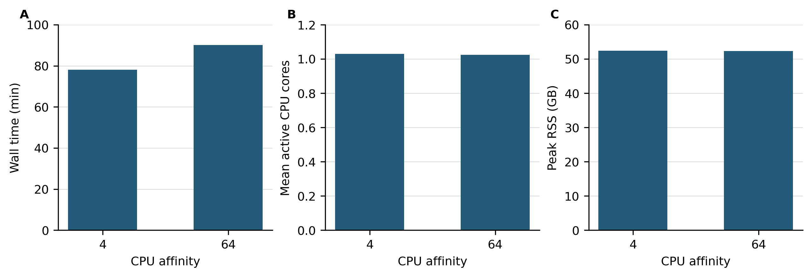
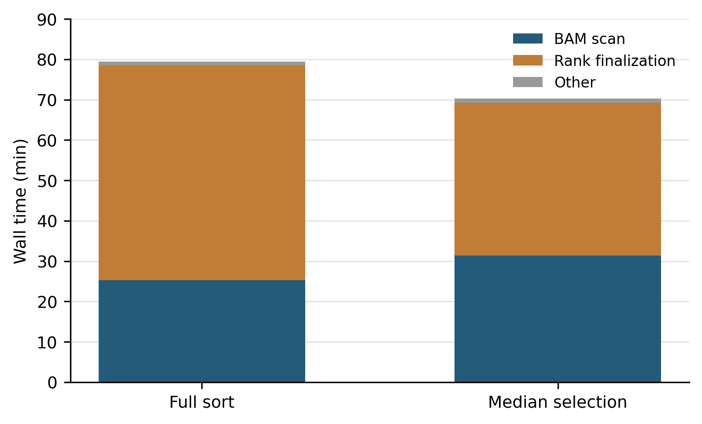

# Taxstats optimization — 22 October 2026

Three alternating previous/optimized runs on the same Mac, four requested threads. The baseline is the locally corrected taxstats version immediately before this optimization, not upstream dev2. Measurements include taxonomy loading, BAM header loading, computation and TSV output. They exclude the earlier accession-map preparation and BAM filtering/sorting. No cache eviction was performed; these are repeated warm-cache measurements, not independent machine replicates. CPU time is user + system process time from os.wait4; memory is process peak resident set size, in decimal GB.

Input: ANI 93–100 ALLTOP coordinate-sorted Lib_LV7008960905_collapsed BAM; 8,189,896 alignments and 1,806,272 reference dictionary entries. Settings: genus, k=17, minreads=10. Mapping: the previously validated BAM-specific subset of 1,806,017 accessions, including the seven genus-consensus mappings. Full 311.6-million-row Phylo Norway map ingestion is not included.

| Measure | Previous mean (range) | Optimized mean (range) | Reduction |
|---|---:|---:|---:|
| Runtime (s) | 25.474 (25.281–25.757) | 13.783 (13.516–13.927) | 45.9% |
| CPU time (s) | 27.143 (26.926–27.406) | 15.423 (15.160–15.557) | 43.2% |
| Peak RSS (GB) | 2.575 (2.512–2.620) | 1.732 (1.728–1.736) | 32.7% |

## Figure caption

Figure 1. End-to-end taxstats runtime (A), CPU consumption (B) and peak resident memory (C) before and after optimization. Points show each of three runs; thin grey lines connect alternating benchmark pairs, and black horizontal marks show arithmetic means. Axes begin at zero. Source values are in measurements.csv; scripts and JSON logs accompany the figure.

## Changes

- Replaced a 288-byte per-reference refstats value with a 32-byte taxstats coverage value (hash-table and event-array overhead are additional).
- Removed spatial histogram, entropy, Gini and truncated-depth calculations whose results taxstats does not emit. The existing coverage event sweep and aggregation order are preserved.
- Cached taxonomy lookup for consecutive alignments on the same reference; this uses constant memory and also works on unsorted input.
- Updated taxon values in place instead of copying 1,288 bytes into and out of the hash map per alignment.
- Reused the validated rolling canonical k-mer encoder and added a four-sequence exact DUST cache. Original k-mer boundaries and invalid/short-sequence behavior are preserved.
- Freed rejected taxa’s coverage arrays and k-mer maps, and cleared finalized vectors so cleanup handles both completed and incomplete state.

## Result validation

All six final full-BAM TSVs are byte-identical, including row order, all 28 columns and all 4,232 rows. SHA-256: 34d8a0963387fe32edca6782f34422b008e4b446d7b954aefc8e1f5ae4b13d47. Counts remain 8,150,528 output alignments and 242,235 distinct output QNAMEs; 547 alignments lack usable taxonomy. The existing 20 non-genus fallback rows remain unchanged.

An independent coverage regression uses overlapping/gapped alignments across short and long references, two taxa, unsorted/coordinate/XR input and one/four threads. It checks covered bases, mean coverage, mean depth on covered bases and its standard deviation against a basewise oracle. All 27 release tests and all 27 AddressSanitizer/UndefinedBehaviorSanitizer tests passed (leak detection disabled). All 45 small-file differential comparisons were byte-identical across unsorted/coordinate/XR inputs, k=1/17/32, read lengths 1–300, ambiguous bases and filters. The installed binary matches the benchmarked SHA-256 and passed the coverage smoke test. Details are recorded in validation-status.json and the associated logs.

## Scale and remaining work

This is a measured improvement, not a demonstration on a 1 TB BAM. The ordinary taxstats path still retains alignment ANI values and coverage events until finalization, plus exact read and k-mer sets. Memory therefore still grows with input complexity and alignment count. XR-sorted input can buffer an entire taxon. The next substantial scalability step is bounded reference/taxon partitioning with exact spill/merge algorithms; merely adding worker threads would multiply live state and can increase memory.

Taxonomy loading alone takes approximately 5.4 seconds here and is serial; main alignment aggregation remains serial with threaded BAM decompression. The changes preserve arithmetic order rather than introducing parallel reductions that could perturb rounded results. Existing 32-bit read-length bins/median-length parameters and hash-table capacity limits also need attention before claiming unrestricted scale.

An existing CLI inconsistency was observed: --minmani accepts 0–1 while taxstats compares it to mean ANI on a 0–100 scale. This optimization preserves that behavior; it should be corrected separately with an explicit interface decision. Legacy 255-base k-mer-window behavior is also preserved.

## Exact multi-rank update — 23 November 2026

`--ranks family,genus,species` now loads taxonomy and scans the BAM once,
while maintaining separate exact read-name sets and statistics for each rank.
On coordinate-sorted input it finalizes each reference as its TID ends and
shares that reference's coverage and spatial calculation across the ranks.
The single-rank coordinate path also uses this streamed engine. Taxstats no
longer calculates TAD80, which it does not report.

Three alternating warm-cache measurements on the same Mac used the
213,470,007-byte filtered coordinate BAM (8,189,896 alignments, 1,806,272
header references), the validated BAM-specific accession map, `-k 17`,
`--minreads 10` and four requested threads. Median wall time for three
separate ranks was 76.927 s versus 36.922 s for one multi-rank run; CPU time
was 82.084 versus 38.758 s. Peak RSS was 2.945 GB for the largest separate
process versus 3.789 GB for the combined process. All 18 decompressed output
pairs (three ranks, statistics and read-length companions, three repetitions)
were byte-identical. A new regression checks coordinate and XR-sorted input,
rank-specific read filtering, spill behavior and mislabeled coordinate order.
These observations do not establish performance or a hard RAM bound on a
terabyte-scale BAM; `--memory-limit` remains a soft spill trigger.

## Large BAM CPU scaling and median selection — 24 November 2026

We tested a completed validation sample, KapK12139, on Dandy-07. Its original
queryname BAM is 68,648,217,842 bytes. `alnfilt --mode ALLTOP --minani 93
--maxani 100` retained 542,356,556 of 4,191,264,109 alignments; the
coordinate-sorted filtered BAM is 20.86 GB. The reference header has
31,153,551 entries. All taxstats runs used the same accession map and NCBI
taxonomy, `--ranks family,genus,species -k 17 --minreads 10
--memory-limit 128G`, and low process priority. Input filtering and sorting
are excluded from the times below.

| Build and CPU affinity | Wall time | CPU time | Peak RSS |
|---|---:|---:|---:|
| Previous one-pass build, 4 CPUs | 78.16 min | 80.53 min | 52.38 GB |
| Previous one-pass build, 64 CPUs | 90.05 min | 92.20 min | 52.34 GB |
| Parallel rank finalization, 4 CPUs | 79.47 min | 108.28 min | 51.02 GB |
| Parallel rank finalization + ANI median selection, 4 CPUs | 70.23 min | 100.80 min | 51.08 GB |

The old build used about one active core with either 4 or 64 CPU affinity;
64 CPUs were 15.2% slower in this one-run comparison. Its alignment scan
and rank-finalization loop were serial. The updated build can finalize
separate ranks concurrently, capped by the requested threads and rank count,
but its BAM scan remains serial. On this large sample, rank concurrency alone
did not improve whole-run wall time; the slowest rank dominated. CPU affinity
does not reserve cores, and Dandy-07 was shared, so cross-day comparisons
cannot give a precise code speedup.

*Figure 1.* One run per setting with the previous one-pass build on the same
filtered sample. Panels show wall time (A), mean active CPU cores (B), and
peak resident memory (C). No uncertainty intervals are shown because there
was no replication; host load was not controlled.

The median-selection build replaces a full sort of each taxon's ANI
observations with in-place median selection. A depth limit falls back to
the previous sort for adverse partitions; nonfinite values and negative zero
also use the previous path. On the **same byte-identical coordinate BAM**,
the rank-parallel build with full ANI sorting spent 25.26 minutes scanning
and 53.21 minutes
finalizing; the selection build spent 31.35 and 37.80 minutes. Its finalization
was 29.0% shorter, whole-run wall time 11.6% shorter, CPU time 6.9% lower,
and peak RSS effectively unchanged. The selection run's scan was slower
under different shared-host conditions; host load was not measured. Three
paired runs on a 204 MB Mac BAM showed only a 1.0% median whole-run gain.

*Figure 2.* Two four-CPU runs of the same coordinate BAM and taxonomy,
partitioned into measured scan, rank-finalization, and other time. The only
code difference is ANI median selection. The host was shared and each build
ran once, so the bars show observed times without uncertainty intervals.

All six decoded BGZF outputs—main and read-length tables for family, genus
and species—had identical SHA-256 hashes and line counts across the four
large runs and the previously published separate-rank outputs. The full
41-test suite passed for both experimental builds on Dandy-07. The older
three-separate-rank validation timing used another executable and host, so
it is context rather than a controlled speed baseline.

Four CPUs per three-rank job is a reasonable starting allocation. Running
independent samples concurrently can use a larger server more effectively,
but this sample peaked around 51 GB RSS per job, and shared storage may
limit concurrency. `--memory-limit` triggers eligible allocations to use
scratch; it is not a hard resident-memory cap. These tests do not certify
performance or memory use for a 1 TB BAM. Further work should profile the
remaining long rank and exact read-name unions before adding more workers.

The timed server binaries predate the current local safeguard that checks RSS
immediately before choosing the rank-worker count.
